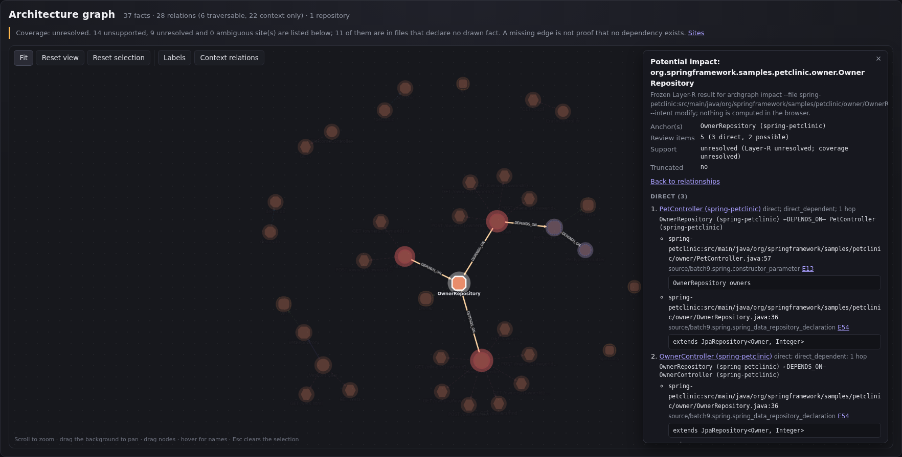
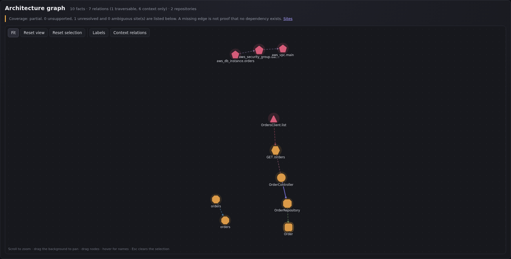

# Architecture Graph

**Understand your architecture. Before you change it.**

**AI-agents produce a lot of code at a fast pace, we need to monitor their influence of codebase to reduce the unwanted influence on codebase.**

Architecture Graph discovers evidence-backed relationships in one or more repositories, renders them as an interactive graph, and shows the supported review impact of a file change. Analysis is local and deterministic: no LLM calls, API keys, source uploads, or application startup.

Architecture Graph is proprietary software. The product source is not published in this repository. The distributed archive contains bundled JavaScript that remains inspectable; that visibility is not an open-source license or a claim that the implementation is secret.



_Spring PetClinic `OwnerRepository` selected with its frozen five-item change-impact result. Every highlighted path is backed by stored source evidence._

> **v0.2.0-rc2 release candidate** · Linux x86-64 · Node.js 22.x
> Independently accepted in a clean room: 36/36 gates passed. Unsupported and unresolved patterns remain visible; a missing edge never means a change is safe.



_Complete stored graph from the bundled `orders` and `billing` demo: 10 facts and 7 evidence-backed relationships across two repositories._

## Download and quick start

> **Evaluation license:** Before downloading or using this release, review the
> [Architecture Graph Proprietary Evaluation License](docs/PROPRIETARY_LICENSE.md).
> Installing or executing the software constitutes acceptance of those terms
> and starts the evaluating organization's 90-day period. The license permits
> worldwide internal evaluation, testing, and internal demonstrations only;
> production use, commercial use, external redistribution, sublicensing, and
> modification are not licensed except where applicable law requires otherwise.

Download `architecture-graph-mvp-0.2.0-rc2-linux-x64.tar.gz` from the [v0.2.0-rc2 release page](https://github.com/jppinker/architecture-graph/releases/tag/v0.2.0-rc2). Download the release asset, not GitHub's automatically generated source archive.

```sh
tar -xzf architecture-graph-mvp-0.2.0-rc2-linux-x64.tar.gz
cd architecture-graph-mvp
./archgraph doctor
./archgraph demo --no-open
```

The demo writes an overview report, an impact report, and `runs/demo-v2/analysis/report-graph.html`. Open the graph directly from disk in Chrome or Chromium; it needs no server, CDN, font, or network access.

Analyze repositories and inspect a change:

```sh
./archgraph analyze /path/to/repository [/path/to/another ...] --output runs/my-analysis
./archgraph impact --analysis runs/my-analysis --file <repo-id>:<relative-file> --intent modify --output runs/my-impact
./archgraph report runs/my-impact
./archgraph graph runs/my-analysis
```

The repository id is the directory name. Optional `--workspace <file>` declarations prove Kafka/PostgreSQL identities; optional `--http-services <file>` declarations prove service-name-to-repository bindings. Equal names alone never create a relationship.

## What it discovers

- Imported or fully qualified Spring stereotypes and uniquely resolved constructor injection.
- JPA entity declarations and Spring Data repository-to-entity ownership.
- Literal Spring MVC handler mappings and OpenFeign calls; cross-repository `CALLS_ENDPOINT` requires explicit service binding and configuration evidence.
- Plain committed Kubernetes `v1/Service` to `apps/v1/Deployment` selection.
- Bounded Terraform resource declarations and direct local references.
- The existing proven Kafka and PostgreSQL relationships from v0.1.1.

Every fact and relationship retains its canonical id, repository-relative source location, rule, span, and evidence reference. The HTML report links graph elements back to that evidence and reports partial, unsupported, unresolved, ambiguous, and truncated analysis explicitly.

## Explore the graph

- Click a node for outgoing dependencies, incoming dependents, canonical identity, source file, and evidence.
- Choose **Show potential impact** to display the stored Layer-R result for that node's file. Nothing is traversed in the browser.
- Click an edge for its evidence. Search names, filter repositories or relation types, drag nodes, pan, zoom, fit, or reset.
- Solid edges are traversed by supported impact analysis. Dashed edges are verified architecture context only.

The original demo proves cross-repository HTTP, Kubernetes, Terraform, Spring, and JPA relationships without bundling any third-party repository. A self-contained interactive copy is prepared at [`demo/index.html`](demo/index.html) for an optional GitHub Pages deployment.

## Honest limitations

- This is a bounded static analyzer, not a general Java call graph, compiler, or runtime observer.
- `MANAGES_ENTITY`, HTTP, Kubernetes, and Terraform relationships are architecture context; they are not impact paths.
- JPA `@Table` is a logical mapping unless independent datasource/schema evidence proves a physical PostgreSQL table.
- Kubernetes facts describe committed desired configuration, not a live cluster. Helm templates and Kustomize rendering are not interpreted.
- Terraform facts do not prove that `apply` ran, that cloud resources exist, or what their runtime endpoints are. Modules, data sources, dynamic counts, `for_each`, and variable evaluation are outside the bounded subset.
- PiggyMetrics' real Feign calls remain unresolved because their required service configuration is outside the supported HTTP rule.
- Graph pages were tested in Chrome/Chromium. Large graphs use documented drawing bounds, and impact is precomputed for at most 300 source files per page.
- Native macOS and Windows are not supported by this release candidate.

Graph reachability means review relevance, not guaranteed runtime breakage. Unsupported technology or unresolved evidence can hide relationships.

## Privacy and licensing

Analysis reads local repositories without modifying them. It makes no network or model calls and uploads nothing. Reports use repository-relative paths, withhold sensitive excerpts, HTML-escape values, and use a content security policy that blocks remote resources.

- [Release identity and distribution boundary](docs/RELEASE.md)
- [Architecture Graph Proprietary Evaluation License](docs/PROPRIETARY_LICENSE.md)
- [Runtime dependency notices](LICENSES/THIRD_PARTY_NOTICES.md)
- [Product notice](LICENSES/NOTICE.md)
- [v0.1.1 historical release](https://github.com/jppinker/architecture-graph/releases/tag/v0.1.1)
- [Issues and feedback](https://github.com/jppinker/architecture-graph/issues)

The rc2 archive includes the required third-party license texts. The same notices are retained under [`LICENSES/`](LICENSES/) in this repository. The proprietary evaluation license is a publish-ready draft requiring the approvals listed in its Section 15; it is not effective until MENTORIX LLC publishes it with the release. Repository visibility and inspectable bundled JavaScript do not grant open-source rights. Third-party licenses remain unaffected.

## Integrity

```text
51f79f3811730c147853c38205d33aa714bf9faa91c80c9da33226a978837d9a  architecture-graph-mvp-0.2.0-rc2-linux-x64.tar.gz
```

The archive is distributed separately as the GitHub Release asset and is not stored in this repository. Use the release asset for installation; do not use GitHub's automatically generated source archives.
